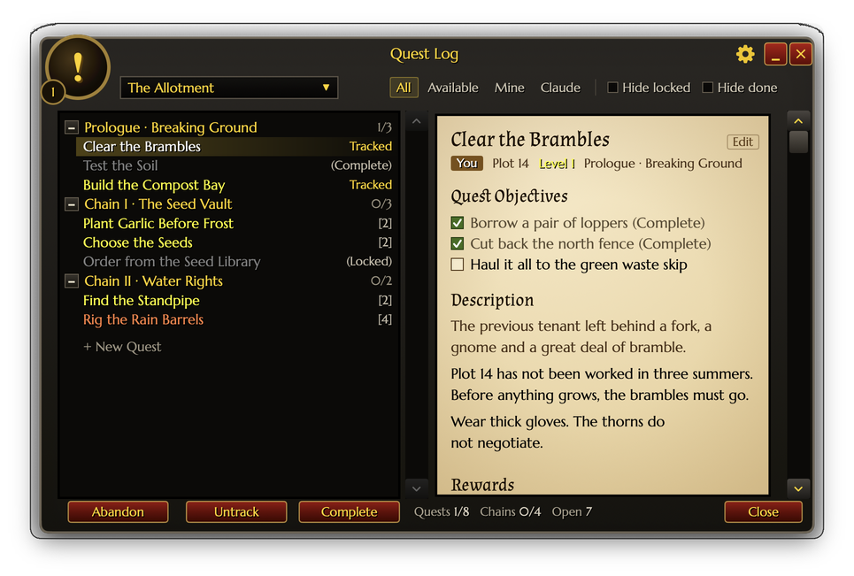
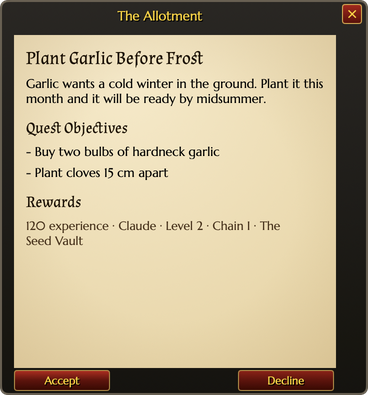

# Quest Log

Track any project as quests, in the style of an MMO quest log: quest chains, objectives, levels and XP, a floating objective tracker, a quest window that pops up for new quests, and a `quest` command and MCP server for you and your coding agents. A native macOS app (Swift and SwiftUI). Nothing leaves your Mac.

<p align="center"> </p>

- **Data:** `~/.questlog/projects/<slug>.json` (one file per project) and `~/.questlog/settings.json` (current project, tracked quests). Set `QUESTLOG_HOME` to use another folder.
- **App:** a menu bar app with the quest log window, the tracker and the new-quest window. It picks up changes made by the CLI within a second.
- **CLI:** `quest`. Run `quest help` for every command.

Requires macOS 15 or later and Swift 6 (Xcode 16 or the command line tools).

## Install

```sh
./build.sh install    # ~/Applications/Quest Log.app and ~/.local/bin/quest
```

`./build.sh` alone builds both into `build/`.

## CLI

```sh
quest                                  # next quests in the current project
quest projects / quest use <slug>
quest project new house "House move"
quest chain add "Paperwork" --id paperwork
quest add "Get the residence card" --chain paperwork --lvl 3 --obj "Book appointment" --obj "Go to ward office"
quest check <quest> 1 2                # objectives by number, id or "all"
quest complete|accept|decline|abandon|restore|track|untrack <quest>
quest show <quest> / quest ls --all --locked / quest json
quest open [<quest>]                   # open the quest log at a quest
```

`quest add` offers the quest: the app shows a quest window with Accept and Decline. Add `--active` to skip that.

## Agents

Agents can use the same `quest` commands (`quest json` prints a whole project), or the built-in MCP server:

```sh
claude mcp add questlog -- quest mcp
```

Tools: `list_projects`, `show_project`, `add_quest` (offered by default, so you accept or decline what the agent proposes), `set_objectives` and `quest_action` (complete, accept, decline, abandon, restore, track, untrack, remove). The app plays the sounds and shows the new-quest window for changes made by agents too.

## Keys

⌃⌥L opens or closes the quest log, ⌃⌥T shows or hides the tracker, ⌃⌥N starts a new quest. Change them with the gear in the log window.

## Look

Out of the box the app uses its own drawn frames, the [Marcellus](https://fonts.google.com/specimen/Marcellus) and [Almendra](https://fonts.google.com/specimen/Almendra) fonts (SIL Open Font License, in `Resources/Fonts`) and synthesized sounds.

If you own World of Warcraft, `scripts/setup-theme.sh` copies the quest log art, fonts and sounds from **your own install** into `~/.questlog/theme`. Nothing from the game is included in this repository or downloaded. The script builds [CascLib](https://github.com/ladislav-zezula/CascLib) (to read the game's storage) and needs git, the Xcode command line tools and [uv](https://docs.astral.sh/uv/):

```sh
scripts/setup-theme.sh                                    # finds the game in /Applications or ~/Games
scripts/setup-theme.sh "/path/to/World of Warcraft" wow   # or name the folder and product
```

Then choose Reload Theme in the menu bar.

You can also put your own files in `~/.questlog/theme/` (menu: Open Theme Folder):

| File | Replaces |
| --- | --- |
| `sounds/open.*`, `close.*` | quest log opening and closing |
| `sounds/offer.*`, `accept.*` | new quest window, accepting a quest |
| `sounds/objective.*`, `complete.*`, `levelup.*`, `abandon.*` | progress sounds |
| `fonts/ui.ttf`, `fonts/title.ttf` | interface and heading fonts |
| `textures/*.png` | the frames and buttons (names as written by the extract script) |

Sounds can be `.ogg`, `.mp3`, `.wav`, `.m4a` or `.caf`.

## AeroSpace

The log window is a normal window that tiles. AeroSpace floats it by default because its title bar is hidden; to tile it, add:

```toml
[[on-window-detected]]
if.app-id = 'com.davafons.questlog'
run = 'layout tiling'
```

## Development

```sh
swift build && swift test
.build/debug/QuestLog --open                 # run without installing
.build/debug/QuestLog --panel options        # or: new, edit
QUESTLOG_HOME=/tmp/ql .build/debug/quest ... # try things on a copy of the data
```

- `Sources/QuestCore`: data model, rules (quest states, XP, levels) and file storage, shared by the app and the CLI.
- `Sources/quest`: the CLI.
- `Sources/QuestLog`: the app.

Not affiliated with or endorsed by Blizzard Entertainment.
